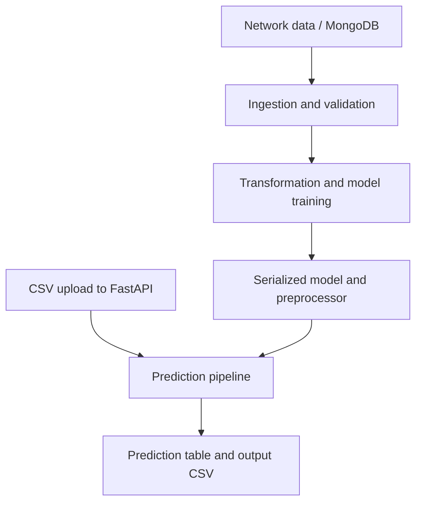

# Network Security — ML Training and FastAPI

Machine-learning pipeline and FastAPI application for network-security classification, training, and CSV prediction.

## Project focus

Application / engineering project. The sections below separate the runnable entry point, source layout, prerequisites, and verification path.

## Architecture



## Repository structure

| Path | Purpose |
| --- | --- |
| [`.github/`](.github) | Repository automation and workflows. |
| [`Dockerfile`](Dockerfile) | Container image build instructions. |
| [`LICENSE`](LICENSE) | Repository licensing terms. |
| [`Network_data/`](Network_data) | Project-specific source, resources, or learning material. |
| [`app.py`](app.py) | Application entry point or route definitions. |
| [`data_schema/`](data_schema) | Project-specific source, resources, or learning material. |
| [`final_model/`](final_model) | Serialized inference model and preprocessing artifacts. |
| [`main.py`](main.py) | Program or workflow entry point. |
| [`networksecurity/`](networksecurity) | Data ingestion, validation, transformation, training, and prediction modules. |
| [`prediction_output/`](prediction_output) | Project-specific source, resources, or learning material. |
| [`push_data.py`](push_data.py) | Python application helper or learning example. |
| [`requirements.txt`](requirements.txt) | Python dependency manifest. |
| [`setup.py`](setup.py) | Python application helper or learning example. |
| [`templates/`](templates) | Server-rendered HTML templates. |
| [`test_mongodb.py`](test_mongodb.py) | MongoDB connectivity example; configure credentials locally before use. |
| [`tests/`](tests) | Automated checks and regression cases. |
| [`valid_data/`](valid_data) | Project-specific source, resources, or learning material. |

## Getting started

```bash
git clone https://github.com/Raimal-Raja/Network-Security-System.git
cd Network-Security-System
```

```bash
python -m venv .venv
source .venv/bin/activate
```

On Windows PowerShell, activate the environment with `.venv\Scripts\Activate.ps1` instead.

```bash
python -m pip install -r requirements.txt
```

Configure the MongoDB connection expected by the source and make trusted inference artifacts available in `final_model/`.

```bash
python -m uvicorn app:app --host 127.0.0.1 --port 8000
```

Model training is a separate workflow. Do not assume `pip install -e .` is portable: inspect the existing `setup.py` before using that installation route.

## Configuration and scope

Training and data ingestion require a configured MongoDB connection. Inference requires compatible trusted model/preprocessor artifacts. Dependency repair does not rotate account credentials, retrain models, or repair unrelated source-code regressions.

## Verification

```bash
python -m unittest discover -s tests -v
```

Install the selected project dependencies and optional test prerequisites first. Some integration checks require model artifacts, databases, or external services.

## Contributing

Include reproduction steps, the affected path, expected behavior, and the checks you ran. Keep credentials, generated environments, and unnecessary build artifacts out of commits.

## License

See [LICENSE](LICENSE) for the repository's license.
